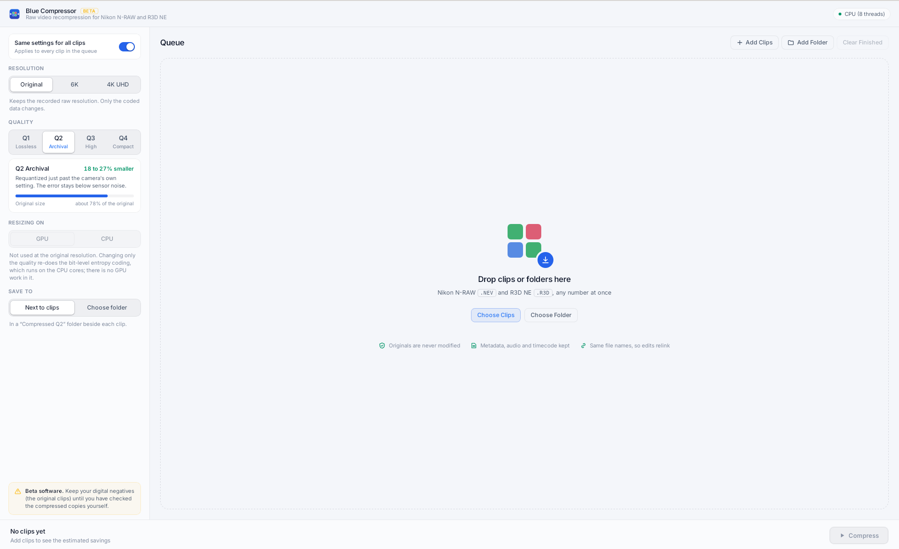

# Blue Compressor

## Download

**[Latest release (v0.1.0 beta)](https://github.com/redn3/blue-compressor/releases/tag/v0.1.0)**. Pick the file for your computer:

| Your computer | Download |
| --- | --- |
| Mac with Apple silicon (M1, M2, M3, M4, M5) | [Blue-Compressor_0.1.0_macOS_arm64.dmg](https://github.com/redn3/blue-compressor/releases/download/v0.1.0/Blue-Compressor_0.1.0_macOS_arm64.dmg) |
| Mac with Intel processor | [Blue-Compressor_0.1.0_macOS_x64.dmg](https://github.com/redn3/blue-compressor/releases/download/v0.1.0/Blue-Compressor_0.1.0_macOS_x64.dmg) |
| Windows 10 or 11 | [Blue-Compressor_0.1.0_Windows_x64-setup.exe](https://github.com/redn3/blue-compressor/releases/download/v0.1.0/Blue-Compressor_0.1.0_Windows_x64-setup.exe) |
| Linux (any distribution) | [Blue-Compressor_0.1.0_Linux_x64.AppImage](https://github.com/redn3/blue-compressor/releases/download/v0.1.0/Blue-Compressor_0.1.0_Linux_x64.AppImage) |

Not sure which Mac you have? Open the Apple menu and choose About This Mac. If it says "Chip", get Apple silicon; if it says "Processor" with Intel, get Intel.

Other formats (Windows `.msi`, Linux `.deb` and `.rpm`) and the command line tool are on the [release page](https://github.com/redn3/blue-compressor/releases/tag/v0.1.0).

Blue Compressor makes Nikon **N-RAW** (`.NEV`, e.g. Z8, Z9, Z6III) and **R3D NE**
(`.R3D`, e.g. Nikon ZR) clips smaller. It re-encodes the TICO RAW (JPEG XS) data inside
them and keeps everything else as it was: the raw Bayer data stays raw, and the
container, metadata, timecode and audio are untouched. The output is an ordinary clip
meant to open in the same software as the camera originals.

There is a desktop app (macOS, Windows, Linux) with drag and drop and a before/after
quality previewer. There is also a headless command line tool and a C API for scripts
and build servers.



> **Status: early and experimental.** It has been tested on one Z8 clip and one ZR clip,
> on macOS (Apple silicon). Keep your originals until you have checked the outputs in
> your own pipeline.

## What it does

| Setting | What happens | Z8 8K N-RAW (2.60 GB) | ZR 6K R3D NE (2.14 GB) |
| --- | --- | --- | --- |
| **Q1 Lossless** | Repacks the coded data without the camera's padding. Every decoded pixel is identical. | 2.36 GB (−9%) | 2.05 GB (−4%) |
| **Q2 Archival** (default) | Requantizes one notch past the camera's own setting. | 2.12 GB (−18%) | 1.58 GB (−27%) |
| **Q3 High** | One step further. | 1.59 GB (−39%) | 1.22 GB (−43%) |
| **Q4 Compact** | For offline and reference copies. | 0.99 GB (−62%) | 0.90 GB (−58%) |
| **6K** (Q2) | Area-scales each CFA colour plane in linear raw to 6048 × 3402, then re-encodes. | 0.94 GB (−64%) | (already 6K) |
| **4K UHD** (Q2) | Same, to 3840 × 2160. | 0.49 GB (−81%) | 0.56 GB (−74%) |

These were measured on one sample clip from each camera; your footage will vary with
content, ISO and the camera's quality setting. Q1 outputs decode to exactly the same
coefficients as the originals.

Speed on a recent Apple silicon laptop: quality-only changes run at about 40 to 55 fps (entropy
decoding and encoding on all CPU cores). 8K to 6K runs at about 31 fps with Metal and
12 fps on the CPU alone.

### How it works

TICO RAW is a JPEG XS variant: four Star-Tetrix decorrelated components on the 2 × 2
Bayer quad grid, a 5/3 wavelet (five horizontal levels, one vertical), and a
square-root companding transfer curve. Blue Compressor:

* **Q1 to Q4**: entropy-decodes every precinct and requantizes the coefficients with a
  coarser truncation (never finer than the camera's). It then re-encodes with the
  cheapest coding modes and rebuilds the container's sample tables. Nothing is
  transformed, so there is no generation loss beyond the chosen quantization.
* **6K / 4K**: decodes fully to the Bayer mosaic, then converts to linear raw. It
  area-resamples each CFA plane with phase-correct footprints (a box filter, so no
  ringing next to clipped highlights) and runs the forward transforms again. The
  geometry stages run on the GPU (Metal on macOS, optional CUDA); entropy coding stays
  on the CPU.

## Repository layout

```
crates/core      Rust library: codec, container, transcoder, GPU backends, C API
crates/cli       `bluecompress` command line tool
app/src-tauri    desktop app (Tauri 2) and app/ui (HTML, CSS, JS, no build step)
```

## Building

You need [Rust](https://rustup.rs) 1.88 or newer.

```bash
cargo build --release -p bluecompress-cli
./target/release/bluecompress --help
```

This also builds the core library: `target/release/libbluecompress.{a,dylib,so}` or
`bluecompress.{lib,dll}`. Its C header is `crates/core/include/bluecompress.h`.

GPU backends:

* **Metal** is on by default on macOS (the shaders are compiled at run time).
* **CUDA** is behind a feature flag: `cargo build --release -p bluecompress-cli --features cuda`.
  The CUDA driver and NVRTC are loaded at run time, so building needs no CUDA toolkit.
  NVRTC is not part of the NVIDIA driver and has to be installed separately. On Windows it
  must be NVRTC **12.x** (`nvrtc64_120_0.dll` plus its `nvrtc-builtins64_12*.dll`), next to
  `bluecompress.exe` or on `PATH`; NVRTC 13 (`nvrtc64_130_0.dll`) is not picked up.
  **It is untested**: it was written without access to an NVIDIA GPU. Compare its
  output against `--backend cpu` before relying on it, and please report results.

### Desktop app

```bash
cargo install tauri-cli --version "^2"
cd app/src-tauri
cargo tauri dev          # run in development mode
cargo tauri build        # release bundle (.app/.dmg, .msi/.exe, .deb/.AppImage)
```

The app writes each version into a folder named after its setting, next to the clip
(`Compressed Q2/`, `Compressed Q3 4K/`), and keeps the file names so edits relink. Use
**Compress again** on a finished clip to make another version with different settings.

Platform prerequisites are listed in the [Tauri guide](https://v2.tauri.app/start/prerequisites/).
On Linux that means the WebKitGTK and build packages it names; on Windows, WebView2,
which current Windows versions already have. The UI is plain HTML, CSS and JavaScript in
`app/ui`, with no Node toolchain. For UI work without footage, build with
`--features mock`, which fakes the engine with realistic numbers.

## Command line

```bash
# Compress a folder (recursively) into another folder at the default Q2
bluecompress compress /Volumes/CARD -o /Volumes/Archive/compressed

# One clip, explicit output, 6K at Q3 on the GPU
bluecompress compress -q 3 -r 6k clip.NEV --output clip_6k.NEV

# Machine-readable progress for build servers (one JSON object per line)
bluecompress compress --json --skip-existing footage/ -o out/

bluecompress probe --json clip.R3D
bluecompress backends
```

Options: `-q 1..4`, `-r original|6k|4k`, `-b auto|cpu|metal|cuda`, `-j threads`,
`--suffix`, `--overwrite`, `--skip-existing`, `--json`, `--quiet`.

* **Writing outputs**: each output goes to `<name>.partial` and is renamed when
  complete. Originals are never modified. Ctrl+C cancels cleanly.
* **Exit codes**: 0 success, 1 a clip failed, 2 usage error, 3 cancelled.
* **JSON events**: `start`, `progress`, `done`, `skipped`, `error`, `summary`. The `probe`
  command emits `clip` events instead.

## C API

`crates/core/include/bluecompress.h` declares the following:

* `bc_probe`
* `bc_output_size`
* `bc_transcode` (synchronous, with a progress and cancel callback)
* `bc_backend_description`
* `bc_version`

Every call catches panics, so nothing unwinds into C. On Windows, define
`BC_SHARED_USE` when linking the DLL.

## Testing

```bash
cargo test --release -p bluecompress
```

The unit tests cover bit I/O, the reversible transforms and the resampling taps. Camera
footage is not in the repository; to run the end-to-end tests against your own clips,
point `BC_TEST_CLIPS` at a folder of `.NEV` / `.R3D` files:

```bash
BC_TEST_CLIPS=~/footage cargo test --release -p bluecompress --test clips -- --nocapture
```

These check that Q1 decodes to identical coefficients, and that lossy and 4K outputs
parse and decode.

### Checking outputs

Before relying on this for archival, open compressed copies in the software you use for
those clips, compare them with the originals, and check metadata, audio and timecode.

### Determinism

Output is deterministic for a given build and backend. Q1 to Q4 involve only integer
arithmetic and are bit-identical on every platform and backend. Resizing uses float
arithmetic, so CPU, Metal and CUDA outputs, and builds for CPUs with and without FMA,
differ in a few hundred of several million coefficients per frame. The differences
are one quantization step each: float rounding, with no visible effect.

## Contributing

See [CONTRIBUTING.md](CONTRIBUTING.md). Bug reports with a short sample clip, or test
results from cameras, platforms and GPUs not yet covered, are especially welcome.
Security issues: see [SECURITY.md](SECURITY.md).

## Legal

Blue Compressor is licensed under the [Apache License 2.0](LICENSE). See
[NOTICE](NOTICE) for attributions.

* It is an independent project. It is **not affiliated with, endorsed by or supported
  by** Nikon, RED Digital Cinema or intoPIX. Nikon, N-RAW, RED, R3D, R3D NE, REDCODE,
  TICO and TicoRAW are trademarks of their respective owners. They are used here only
  to describe the files this software reads and writes.
* This repository contains no code, headers, libraries or documentation from Nikon, RED
  or intoPIX, and the software does not use, include or require any vendor SDK. The codec
  follows the public JPEG XS standard (ISO/IEC 21122); see NOTICE for the open-source
  references consulted.
* JPEG XS and TICO RAW may be covered by patents in some countries; intoPIX runs a
  licensing program for them. The Apache 2.0 license grants rights only to the
  contributors' own patents, not to third parties' patents. Whether you need a patent
  license to use this software is for you to determine.
* The software is provided "as is", without warranty of any kind (see the license).
  Archival tools can lose data: verify outputs before deleting any originals.
